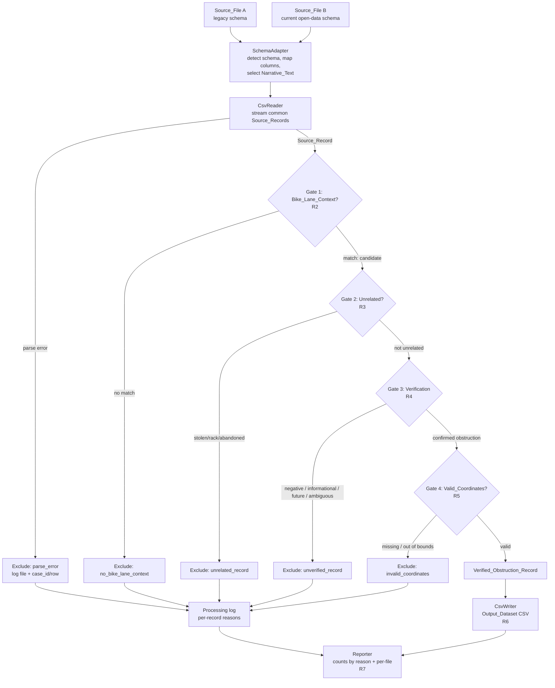

# Design Document

## Overview

The Bike Lane Obstruction Filter is a one-shot, offline data-processing pipeline. It reads one or more Boston 311 service-request exports, classifies each record through a sequence of inclusion and exclusion rules, and writes a single clean CSV containing only **Verified_Obstruction_Records** — records that both confirm a real bike-lane obstruction and carry valid Boston-area coordinates. That output is consumed by a downstream routing application serving cyclists in Boston, which treats each obstruction as an equal-weight safety signal.

The core of the feature is deterministic text classification. The source feed has no "bike lane obstruction" category, so obstructions must be recognized from free-text fields. The pipeline first narrows the feed to records that reference a bike lane, then removes records that mention bikes but are not lane obstructions (stolen bikes, bike racks), then removes records whose narrative indicates no obstruction actually occurred (informational replies, no-violation findings, unable-to-locate, already-clear, future-work-only), keeping only records whose narrative affirmatively confirms an obstruction was present or addressed. A final geographic gate drops any confirmed obstruction without mappable coordinates.

### Multi-year input and schema drift

Boston publishes 311 data as one export per year, and the column schema has changed over time. The pipeline supports two schemas:

- **Legacy schema** (for example `tmp7o3lwr4m.csv`): columns `case_id`, `case_topic`, `service_name`, `closure_comments`, `closure_reason`, `case_status`, `longitude`, `latitude`. Carries a human-written `closure_comments` narrative.
- **Current open-data schema** (2025 and later, for example `lagan_311_open_data_2025_rvsd3.csv`): columns `case_enquiry_id`, `case_title`, `type`, `closure_reason`, `case_status`, `longitude`, `latitude`, and others — with **no `closure_comments`**. The complaint description is redacted for privacy, but a resolution narrative survives inside `closure_reason`.

To span both, each Source_File is routed through a **SchemaAdapter** that maps its columns onto one common internal `SourceRecord`. The adapter also selects **Narrative_Text** — the free-text the verification gate reads — from `closure_comments` under the legacy schema and from `closure_reason` under the current schema. This keeps the classification core schema-agnostic: every gate operates on the common record, never on raw columns.

This design satisfies all seven requirements: multi-file read/parse with schema adaptation (R1), candidate identification (R2), unrelated exclusion (R3), verification (R4), coordinate validation (R5), clean output (R6), and summary reporting (R7).

## Architecture

### Technology Choice

The pipeline is implemented in **Python 3** using the **standard-library `csv` module**. Rationale:

- The task is a one-shot ETL script, not a long-lived service. Python's `csv` reader streams rows and handles embedded commas, quoted fields, and newlines inside quoted narrative text (which appear in the real data) without custom parsing.
- Keeping to the standard library means zero install friction on the target **Windows / PowerShell** environment. `pandas` is intentionally **not** required; a single streaming pass does not need a dataframe, and avoiding the dependency keeps the environment reproducible.
- The classification logic is pure string processing, which Python expresses clearly and which is directly amenable to property-based testing via **Hypothesis**.

Some source files are large (the 2025 export is ~152 MB / ~276k rows), so the reader streams rows and never materializes a whole file. All file paths are resolved relative to the workspace root so the script behaves identically regardless of the current PowerShell working directory.

### Data Flow

The pipeline is a staged filter. Each Source_File is mapped onto common records by its SchemaAdapter; every record then flows through ordered classification gates, and the first gate that rejects it records an exclusion reason and stops its progress. Only records that pass every gate reach the output.

### Gate Ordering Rationale

The gates run in requirement order (R2 to R3 to R4 to R5) because each stage assumes the previous one passed:

1. **Bike_Lane_Context (R2)** runs first because it is the cheapest, broadest filter and every later gate only makes sense for records that mention a bike lane.
2. **Unrelated (R3)** runs before verification so that "bike" records that are clearly off-topic (stolen bikes, racks) never reach the verification keyword logic.
3. **Verification (R4)** is the semantic heart of the pipeline and defaults to exclude when ambiguous. Within this gate, negative signals are evaluated **before** positive ones so a negative always overrides (R4.4).
4. **Valid_Coordinates (R5)** runs last so a confirmed obstruction with bad coordinates is attributed to the coordinate reason rather than hidden behind an earlier gate.

Each record is assigned **exactly one** outcome: either `verified` or one exclusion reason corresponding to the first gate it failed. This single-outcome invariant is what makes the reporting counts (R7) sum cleanly.

## Components and Interfaces

The script is organized into small, independently testable units. The classification functions are **pure** (no I/O), which isolates the testable logic from the file-handling shell.

### `SchemaAdapter`
Maps a Source_File's columns onto the common `SourceRecord`, supporting both schemas.

- `detect(header: list[str]) -> Schema` — inspects the header row and returns the matching `Schema` (`LEGACY` or `CURRENT`), or raises `UnknownSchemaError` naming the file and unrecognized columns (R1.3).
- `to_source_record(row: dict, schema: Schema, source_file: str, row_number: int) -> SourceRecord` — maps columns per the detected schema:
  - Legacy: `case_id`, `case_topic`, `service_name`; Narrative_Text from `closure_comments`.
  - Current: `case_enquiry_id` to `case_id`, `case_title` to `case_topic`, `type` to `service_name`; Narrative_Text from `closure_reason`.
  - Both: `closure_reason`, `case_status`, `longitude`, `latitude` carried through; `source_file` and `row_number` attached for logging.
- The adapter is the only component aware of raw column names; everything downstream reads the common record.

### `CsvReader`
Reads and parses source files.

- `read_records(paths: Iterable[str]) -> Iterator[SourceRecord]`
  - For each path, opens the CSV with `csv.DictReader`, detects its schema via `SchemaAdapter`, and yields one common `SourceRecord` per data row (R1.2, R1.6).
  - Raises `SourceFileNotFoundError` with the attempted absolute path if a file is missing (R1.4).
  - On an unrecognized schema, surfaces `UnknownSchemaError` for that file and continues with the remaining files (R1.3).
  - If a row cannot be mapped to the expected fields, yields a marker that the pipeline logs as `parse_error` and excludes, carrying the originating file (R1.5).
  - Streams rows lazily so large files are never fully materialized.

### `Classifier`
Pure classification logic — the testable core. No file or console I/O. Every function reads the common `SourceRecord` (and its Narrative_Text), never raw columns, so it is identical across schemas.

- `has_bike_lane_context(record: SourceRecord) -> bool` — R2. Case-insensitive, whole-phrase match of `bike lane` / `bike lanes` / `bike line` across `case_topic`, `service_name`, and Narrative_Text; absent/empty/null fields count as no match (R2.2).
- `is_unrelated(record: SourceRecord) -> bool` — R3. True when the record is a stolen/abandoned bicycle or bike rack and not a lane obstruction.
- `verification_outcome(record: SourceRecord) -> Verification` — R4. Returns `CONFIRMED` only when a positive obstruction signal is present and no negative signal overrides it; returns `UNVERIFIED` for informational, negative, future-work, or ambiguous narratives (R4.5 default-exclude).
- `has_valid_coordinates(record: SourceRecord) -> bool` — R5. True when `longitude` and `latitude` are both present, numeric, and within Boston bounds.
- `classify(record: SourceRecord) -> Classification` — orchestrates the four gates in order and returns a single `Classification` (outcome + reason).

### `OutputWriter`
Writes the clean dataset.

- `write(records: Iterable[SourceRecord], path: str) -> int`
  - Writes a header row then one row per Verified_Obstruction_Record with exactly the fields `case_id, case_topic, service_name, closure_comments, longitude, latitude` (R6.3, R6.4). The `closure_comments` column carries the record's Narrative_Text so the output shape is stable regardless of the originating schema.
  - Writes no severity/weight column (R6.5). Returns the number of rows written.

### `ProcessingLog`
Accumulates per-record exclusion records (originating file + `case_id`/row + reason) within the run (R1.5, R3.2, R4.6, R5.4). Backed by an in-memory list and optionally mirrored to a `.log` file.

### `Reporter`
Produces the end-of-run summary (R7): total read across all files, total written, excluded counts grouped by reason (`no_bike_lane_context`, `unrelated_record`, `unverified_record`, `invalid_coordinates`, plus `parse_error`), and — when more than one file is processed — the verified count contributed by each Source_File (R7.4).

### `run_filter` (entry point)
Wires the components: resolve the configured Source_Files relative to the workspace root, open the reader over all of them, for each record `classify` then route to writer or log, then emit the report. This is the only component that performs I/O orchestration.

## Data Models

### `SourceRecord`
A parsed row mapped onto common fields by the SchemaAdapter (other source columns are read but ignored for classification):

| Field | Type | Use |
|-------|------|-----|
| `case_id` | str | Identity, logging, output (`case_id` legacy / `case_enquiry_id` current) |
| `case_topic` | str | Context match, output (`case_topic` legacy / `case_title` current) |
| `service_name` | str | Context match, output (`service_name` legacy / `type` current) |
| `narrative_text` | str | Context match, verification, output; from `closure_comments` (legacy) or `closure_reason` (current) |
| `closure_reason` | str | Available to verification heuristics; also the Narrative_Text source under the current schema |
| `case_status` | str | Available for diagnostics |
| `longitude` | str (raw) to float | Coordinate validation, output |
| `latitude` | str (raw) to float | Coordinate validation, output |
| `source_file` | str | Originating file, for logging and per-file reporting (R1.5, R7.4) |
| `row_number` | int | Fallback identity when `case_id` missing (R1.5) |

### `Schema` (enum)
`LEGACY` | `CURRENT` — the detected Source_Schema of a file.

### `Verification` (enum)
`CONFIRMED` | `UNVERIFIED` — result of the verification gate (R4).

### `ExclusionReason` (enum)
`parse_error` | `no_bike_lane_context` | `unrelated_record` | `unverified_record` | `invalid_coordinates`. These are exactly the reason buckets reported in R7.

### `Classification`
`outcome: "verified" | "excluded"`, and when excluded, `reason: ExclusionReason`. Every record maps to exactly one `Classification`.

### `OutputRecord`
The projection written to the Output_Dataset: `case_id, case_topic, service_name, closure_comments, longitude, latitude` (R6.3), where the `closure_comments` column holds Narrative_Text. No severity or weight field (R6.5).

### Coordinate bounds (R5.2)
Longitude in [-71.3, -70.9], latitude in [42.2, 42.5], inclusive.

## Keyword/Phrase Classification Strategy

Classification is driven by curated, case-insensitive phrase sets applied to normalized text. Normalization lowercases the field and collapses runs of whitespace to single spaces so that punctuation and spacing do not defeat matches (R2.1). All gates read the common `SourceRecord` and its Narrative_Text, so the same vocabulary applies uniformly to both schemas.

### Gate 1 — Bike_Lane_Context (R2)
Match any of `bike lane`, `bike lanes`, `bike line` as a whole word sequence against `case_topic`, `service_name`, and Narrative_Text. Implemented as a regular expression with word boundaries. Missing/empty fields contribute no match (R2.2). A record matching in **any** field becomes a candidate (R2.3); otherwise it is excluded as `no_bike_lane_context` (R2.4).

### Gate 2 — Unrelated_Record (R3)
Exclude candidates whose subject is a bicycle object rather than a lane obstruction. Unrelated indicators: `stolen bike`, `abandoned bike`, `abandoned bicycle`, `bike rack`, `bicycle rack`. Excluded as `unrelated_record` (R3.1) and logged (R3.2).

### Gate 3 — Verification (R4)
Applied to Narrative_Text, with `closure_reason` as a secondary signal. Negative signals are tested **first**; positive signals are honored only when no negative signal is present.

- **Negative / excluding signals** (to `UNVERIFIED`, R4.1-R4.2): `no violation found`, `unable to locate`, `no issue found`, `no bike was found`, `bike lane is clear`, `bike lane clear`, `remains unimpeded`, `no further pruning needed`, `no work needed`, `bike is lift up`, `lifted away`, future-work notes such as `will be serviced` / `going to be serviced`, and informational replies such as `for information on bike lanes`.
- **Positive / confirming signals** (to `CONFIRMED`, R4.3): an obstruction verb/noun combined with bike-lane context. The vocabulary is **broadened** beyond literal "removed from" to capture the addressed-obstruction phrasings seen across years: `removed ... from ... bike lane` (barrels, mattress, glass, debris), `cleared from ... bike lane`, `picked up out of ... bike lane`, `mechanically swept` / `bike lane ... swept`, `pruned back` from a bike lane, `ticketed for bike lane`, `blocking the ... bike lane removed`, `pothole in bike lane`.
- **Precedence (R4.4):** a negative signal **overrides** a positive one. A narrative such as "Bike Lane clear / Ticket issued" is UNVERIFIED because it asserts no standing obstruction, even though "ticket issued" is otherwise a positive phrase. This precedence is mandatory and is the guard that keeps broadened positives from admitting already-clear records.
- **Default (R4.5):** if a candidate matches neither a positive nor a negative signal, classify as `UNVERIFIED` (conservative exclude).

Grounding examples observed in the source data:
- `"Removed barrels from bike lane..."` to CONFIRMED (legacy).
- `"Glass removed from bike lane"` / `"the barrier has been removed from the bike lane"` to CONFIRMED (2025 `closure_reason`).
- `"Items ... picked up out of bike lane"` and `"Tree limb ... cleared from sidewalk and bike lane"` to CONFIRMED under the broadened vocabulary (previously missed).
- `"bike lanes mechanically swept"` to CONFIRMED under the broadened vocabulary.
- `"No violation found by Code Enforcement ... bike lane is clear"` to UNVERIFIED (negative precedence).
- `"bike lane is going to be serviced on Saturday ..."` to UNVERIFIED (future work, nothing yet addressed).
- `"For information on bike lanes, you can email ..."` to UNVERIFIED (informational).

### Gate 4 — Valid_Coordinates (R5)
Parse `longitude`/`latitude` as floats; both must be present and numeric (R5.1) and within Boston bounds (R5.2). Pass to `verified`; fail to `invalid_coordinates` (R5.4).

### Maintainability
All phrase sets and the per-schema column maps live in named module-level constants so the vocabulary and schema support can be reviewed and extended without touching control flow. This is deliberately a heuristic layer; the property tests below pin the structural guarantees independent of the exact vocabulary.

### Expected volume
On the three currently available exports, the broadened vocabulary yields approximately 13 (2024) + 12 (2025) + 3 (2026 partial) = ~28 Verified_Obstruction_Records, up from 9 under the original single-file strict vocabulary. The yield ceiling is set by the Bike_Lane_Context gate: only ~100 records per year mention a bike lane at all. These figures are informative, not asserted by tests; the smoke test asserts only structural/volume sanity.

## Error Handling

- **Unknown schema (R1.3):** `SchemaAdapter.detect` raises `UnknownSchemaError` naming the file and its unrecognized columns; `run_filter` reports it and skips that file without aborting the remaining files.
- **Missing source file (R1.4):** `CsvReader` raises `SourceFileNotFoundError` carrying the attempted absolute path; `run_filter` prints a descriptive message naming the path and exits with a non-zero status before any output is written.
- **Unparseable row (R1.5):** The offending row is excluded, counted under `parse_error`, and its originating file plus `case_id` (or row number) is written to the processing log. Processing continues with the next row.
- **Non-numeric or out-of-range coordinates (R5):** Handled as a normal `invalid_coordinates` exclusion, not an exception.
- **Empty / null text fields (R2.2):** Treated as "no match," never an error.
- **Output write failure:** If the output path cannot be written, `run_filter` surfaces the OS error with the target path; no partial-but-unreported output is claimed as success.
- **Determinism:** Classification depends only on record field values (including the schema-selected Narrative_Text), so re-running on the same inputs yields identical output and identical counts. File processing order is fixed by the configured file order so cross-file output ordering is also deterministic.

## Correctness Properties

*A property is a characteristic or behavior that should hold true across all valid executions of a system — essentially, a formal statement about what the system should do. Properties serve as the bridge between human-readable specifications and machine-verifiable correctness guarantees.*

### Property 1: Every output record has bike-lane context

*For any* set of source records, every record written to the Output_Dataset has Bike_Lane_Context (the phrase "bike lane", "bike lanes", or "bike line" appears, case-insensitively, in its `case_topic`, `service_name`, or Narrative_Text).

**Validates: Requirements 2.1, 2.3, 2.4**

### Property 2: Every output record has valid coordinates

*For any* set of source records, every record written to the Output_Dataset has a `longitude` in [-71.3, -70.9] and a `latitude` in [42.2, 42.5], both numeric.

**Validates: Requirements 5.1, 5.2, 5.3, 6.2**

### Property 3: Excluded-class records never appear in the output

*For any* source record classified as having no Bike_Lane_Context, as an Unrelated_Record, as an Unverified_Record, or as lacking Valid_Coordinates, that record does not appear in the Output_Dataset.

**Validates: Requirements 2.4, 3.1, 4.1, 4.2, 4.5, 5.4, 6.2**

### Property 4: Counts partition the input

*For any* set of source records, the number of records written to the Output_Dataset plus the sum of all excluded-reason counts equals the total number of source records read, and each record contributes to exactly one of those counts.

**Validates: Requirements 7.1, 7.2, 7.3**

### Property 5: Classification is deterministic

*For any* source record, classifying it twice yields the same outcome and (when excluded) the same exclusion reason; equivalently, running the whole filter twice on the same inputs produces identical output and identical counts.

**Validates: Requirements 4.3, 4.5**

### Property 6: Negative signals override positive signals in verification

*For any* Narrative_Text that contains a negative/no-obstruction signal, the verification outcome is UNVERIFIED regardless of whether a positive obstruction phrase is also present.

**Validates: Requirements 4.1, 4.2, 4.4, 4.5**

### Property 7: Output projection shape is exact

*For any* set of source records, every row of the Output_Dataset contains exactly the fields `case_id, case_topic, service_name, closure_comments, longitude, latitude`, the file has a single header row naming those fields, and no severity or weighting column is present.

**Validates: Requirements 6.3, 6.4, 6.5**

### Property 8: Schema adaptation preserves the common record

*For any* Source_File row under either supported schema, the SchemaAdapter maps it to a `SourceRecord` whose `case_id`, `case_topic`, `service_name`, coordinates, and Narrative_Text are populated from the schema-appropriate columns, and the resulting record is classified identically to an equivalent record expressed in the other schema.

**Validates: Requirements 1.2, 1.6**

## Testing Strategy

Property-based testing **is** appropriate here: the classification core is a set of pure functions over string/record inputs with clear universal invariants. The file I/O, schema adaptation, and reporting shell is thin and is covered by example and integration tests.

### Property Tests
- Library: **Hypothesis** (Python). Each correctness property is implemented as a **single** property-based test.
- Minimum **100 iterations** per property test.
- Generators produce synthetic `SourceRecord`s with randomized topic/service/narrative text (including bike-lane phrases with varied casing, punctuation, and whitespace), randomized coordinates (in-bounds, out-of-bounds, missing, non-numeric), and mixes of positive/negative verification signals — including the broadened positive phrases and the negative-precedence combinations. Property 8 additionally generates equivalent rows under both schemas and asserts identical classification.
- Each property test is tagged with a comment in the form: **Feature: bike-lane-obstruction-filter, Property {number}: {property_text}**.

### Unit / Example Tests
Concrete cases drawn from the real data to pin intended behavior and edge cases:
- CONFIRMED (legacy): "Removed barrels from bike lane..."; "tree that was blocking the sidewalk and bike lane removed...".
- CONFIRMED (broadened vocabulary): "Items ... picked up out of bike lane"; "Tree limb ... cleared from sidewalk and bike lane"; "bike lanes mechanically swept".
- CONFIRMED (current schema via `closure_reason`): "Glass removed from bike lane"; "the barrier has been removed from the bike lane".
- UNVERIFIED: "For information on bike lanes, you can email..."; "No violation found by Code Enforcement"; "Unable to Locate"; "bike lane is clear"; "remains unimpeded. No work needed"; "going to be serviced on Saturday"; "no further pruning needed".
- UNVERIFIED by precedence: "Bike Lane clear / Ticket issued for No Stopping violation".
- UNRELATED: a stolen-bike / bike-rack record that still mentions a bike lane.
- Schema adapter: a legacy-schema header and a current-schema header each map to the correct common fields; an unrecognized header raises `UnknownSchemaError` naming the file; the current schema draws Narrative_Text from `closure_reason`.
- R1.4: missing source file raises the descriptive error with the path.
- R1.5: a malformed row is logged under `parse_error` (with its originating file) and skipped without aborting.

### Integration / Smoke Test
- Run `run_filter` end-to-end against small fixture CSVs in **both** schemas (a handful of hand-crafted rows spanning every outcome) and assert: the output contains only the expected verified rows with the exact R6 columns, the processing log lists each exclusion with a reason and originating file, the per-file verified counts are reported (R7.4), and the reported counts satisfy Property 4.
- A smoke run against the real exports confirms the script completes, produces non-empty output, and that reported total-read matches each file's data-row count — validating R1/R7 against production data without asserting exact classifications.

Together the property tests guarantee the structural safety invariants across a wide input space while the example and integration tests pin the concrete vocabulary and schema-adaptation decisions and the I/O/reporting behavior.
